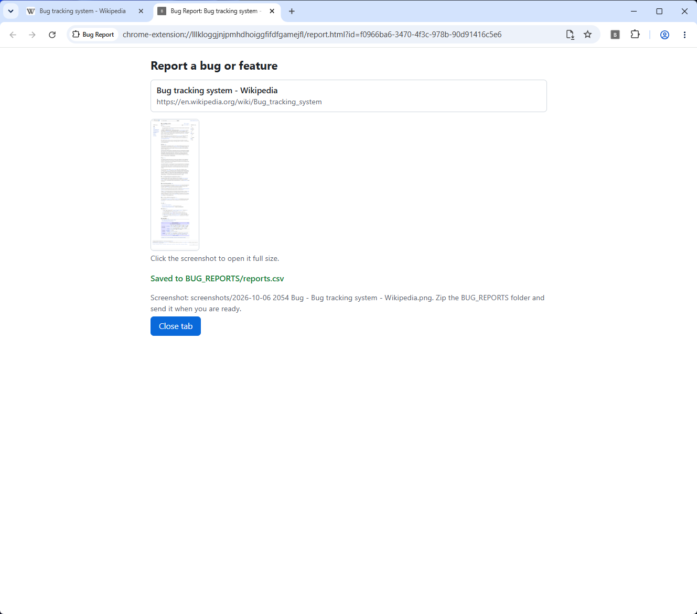

# Bug Capture extension

A Chrome extension (Manifest V3) for sending bug reports and feature requests about any website.
One click takes a full page screenshot of the current tab and opens a short form. The report is
saved on the tester's own PC, in a folder they choose, ready to zip and send. There is no server,
no account and no network call of any kind.



The end user guide, with install steps and screenshots, is
[guide/Bug Report - Install and User Guide.pdf](guide/Bug%20Report%20-%20Install%20and%20User%20Guide.pdf)
(an HTML copy sits next to it). Testers only need that and the release zip.

## How it works

1. The toolbar button (or Alt+Shift+B) starts a report for the active tab. The service worker takes
   the screenshot **before** any UI opens, so the form never appears in the picture, stores it in
   IndexedDB, and opens `report.html?id=<id>` in a new tab.
2. The report tab shows the page title, URL and screenshot, a Bug / Feature choice, two questions and
   the tester's name.
3. **Folder first.** The first Save calls `showDirectoryPicker()` from the click itself and keeps the
   folder handle in IndexedDB. Every later Save writes silently into that folder. If the browser
   later asks again for permission and the tester refuses, or they close the picker, nothing is saved
   and the form stays as it was. Chrome refuses Desktop, Documents and Downloads themselves, so the
   guide tells testers to create a subfolder for reports.
4. **Storage layout** in the chosen folder:

   ```
   <chosen folder>/
     reports.csv          one row appended per report, never rewritten
     screenshots/
       2026-10-06 1432 Bug - Checkout page.png
   ```

   `reports.csv` starts with a UTF-8 BOM and a header, so Excel opens it directly. Columns:
   `id,submittedAt,type,user,url,title,q1_label,q1,q2_label,q2,screenshot,captureMethod,truncated,browser,extensionVersion`.
   Every field is quoted (RFC 4180), and fields starting with `= + - @`, tab, CR or LF get a leading
   `'` so a spreadsheet cannot run them as formulas. The PNG is written first, then the row is
   appended, and a retry of the same report never appends twice.
5. **Zip fallback.** Only when `window.showDirectoryPicker` does not exist, each report is saved as
   one store-only zip (`screenshot.png` + `report.json`) via `chrome.downloads` to
   `Downloads/BugReports/`. The report tab says why before saving.

### Capture

- Primary: `chrome.debugger` on that tab only, `Page.getLayoutMetrics`, then
  `Page.captureScreenshot` with `captureBeyondViewport: true` and a clip of the full CSS content size,
  capped at 16,000 px. The debugger is always detached in a `finally` block.
- While a tab is being brought to the front, a capture can fail or come back with nothing painted
  below the viewport. So the worker captures repeatedly, 150 ms apart, until two consecutive
  captures after the first are byte identical (at most 6 tries). An animated page never matches and
  uses the last capture. The viewport is never resized, so `100vh` layouts and infinite scroll are
  left alone.
- Fallback: `chrome.tabs.captureVisibleTab` (visible part only, recorded as `visible-only`). Pages
  such as `chrome://` and the web store cannot be captured at all, and the report saves without a
  screenshot.

### Browsers

- **Chrome** is the tested and supported browser.
- **Edge** is untested. It is Chromium based and has `showDirectoryPicker`, so it should work, but it
  has not been tried with real users.
- **Brave** removes the folder picker by default (`showDirectoryPicker` is undefined), so every report
  falls back to one zip download, unless `brave://flags/#file-system-access-api` is turned on.

### Permissions

`debugger` (full page capture), `activeTab` (visible-tab fallback and the page title and URL from the
click), `downloads` (zip fallback only) and `storage` (the tester's name). No host permissions, no
remote code and no libraries.

## Repository layout

```
extension/   the unpacked extension: manifest, service worker, report and options pages
tests/       run_e2e.py, the end to end suite (Playwright + Chromium)
guide/       the user guide: shots/ (screenshots), src/ (template and build script), built HTML and PDF
docs/        SPEC.md (current spec with its v1.1 and v1.2 sections), SPEC-v1.md, TEST-SPEC.md
scripts/     build-release.sh
CHANGELOG.md
```

## Running the tests

Needs Python 3 and Playwright for Python with its Chromium:

```
pip install playwright
python3 -m playwright install chromium
python3 tests/run_e2e.py
```

If Playwright's bundled browser does not match your Playwright version, point the suite at a
Chromium or Chrome binary with `--chrome /path/to/chrome`, or set `E2E_CHROME`. `--keep` keeps the
temporary profile and downloads directory for inspection. The suite runs headless, loads
`extension/` unpacked and prints one `PASS` or `FAIL` line per check. See [tests/README.md](tests/README.md).

## Building a release

```
scripts/build-release.sh
```

This reads the version from `extension/manifest.json` and writes
`dist/BugReport-extension-<version>.zip` with `manifest.json` at the zip root. It refuses to build if
anything that is not part of the extension (temp dirs, editor or OS junk, caches) is inside
`extension/`. Attach the zip to a GitHub release. Testers unzip it and use **Load unpacked**.

## Rebuilding the guide

The guide is built from `guide/src/guide.template.html` and the PNGs in `guide/shots/`:

```
python3 guide/src/build.py
```

It embeds the screenshots and writes the HTML (and PDF) into `guide/`.

## Known limits

- Pages taller than 16,000 px are cut off at that height, and the row's `truncated` column says `true`.
- `chrome://` pages, the web store and the new tab page cannot be captured. The report saves without
  a screenshot.
- While the screenshot is taken, Chrome shows a "started debugging this browser" bar for a few
  seconds. Clicking its Cancel stops the full page capture, and the report keeps only the visible part.
- Two rare edge cases are known and not handled:
  - If a tester duplicates an unsaved report tab and saves both copies, `reports.csv` gets two rows
    with the same `id`.
  - A screenshot name is reserved before the file is created. If creating it fails (for example the
    folder permission is revoked mid-save), another report tab saved in the same minute with the same
    type and title can take that name, and a retry of the first report then overwrites that PNG.

## License

MIT, see [LICENSE](LICENSE).
